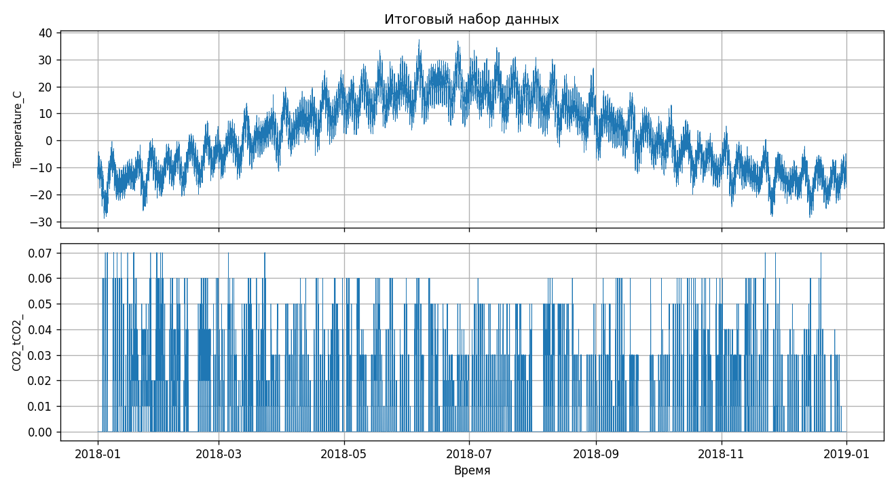

# Отчёт по домашнему заданию 1. Первичный анализ данных

Ноутбук: [`1_homework_eda.ipynb`](1_homework_eda.ipynb)

## Данные

- `Steel_Industry.csv` — энергопотребление сталелитейного предприятия, 35 040 строк × 11 столбцов
  (шаг 15 минут, период 01.01.2018 – 31.12.2018, пропусков нет).
- `температура.txt` — вектор температуры окружающей среды, 35 040 значений.

## Решения

| № | Задача | Решение | Результат |
|---|--------|---------|-----------|
| 1 | Размерность `df_energy` | `df_energy.shape` | `(35040, 11)` |
| 2 | Первые 10 значений `Usage_kWh` | `df_energy["Usage_kWh"].head(10)` | `3.17, 4.0, 3.24, 3.31, 3.82, 3.28, 3.6, 3.6, 3.28, 3.78` |
| 3 | Число элементов `temperature` | `len(temperature)` | `35040` |
| 4 | Мин. и макс. температуры | `(temperature.min(), temperature.max())` | `(-28.9, 37.4)` |
| 5 | Удалить `NSM`, `WeekStatus`, `Day_of_week`, `Load_Type` | `df_energy.drop(columns=[...])`, затем `list(df_energy.columns)` | 7 столбцов: `date` … `Leading_Current_Power_Factor` |
| 6 | Добавить `Temperature_C` | `df_energy["Temperature_C"] = temperature` | первые значения `-12.3, -9.8, -9.7` |

Все шесть ячеек самопроверки в ноутбуке показывают ✅.

## Итоговый график

Показаны `Temperature_C` и `CO2_tCO2_` за 2018 год (данные отсортированы по времени).

## Наблюдения

- Длина вектора температуры (35 040) совпадает с числом строк таблицы, поэтому столбец добавляется
  простым присваиванием. Значения сопоставляются по порядку строк, а не по дате.
- Строки в исходном файле не идут строго по времени (порядок дат нарушается 729 раз),
  поэтому перед построением графика ноутбук сортирует таблицу по `DateTime`.
- Температура заметно меняется по сезонам: от −28.9 до 37.4 °C, среднее около 2.3 °C.
- `CO2_tCO2_` почти линейно связан с `Usage_kWh` (корреляция ≈ 0.99), то есть выбросы определяются
  потреблением электроэнергии.
- Корреляция температуры с потреблением и CO2 близка к нулю (≈ 0.04–0.05): по этим данным
  прямой линейной зависимости нет.

## Выводы

Данные загружены из двух разных форматов (CSV через `pandas`, текстовый вектор через `numpy`),
проверены по размерности и диапазонам, очищены от лишних столбцов и объединены в один
`DataFrame`. Итоговая таблица содержит 7 исходных числовых столбцов плюс `Temperature_C`.
